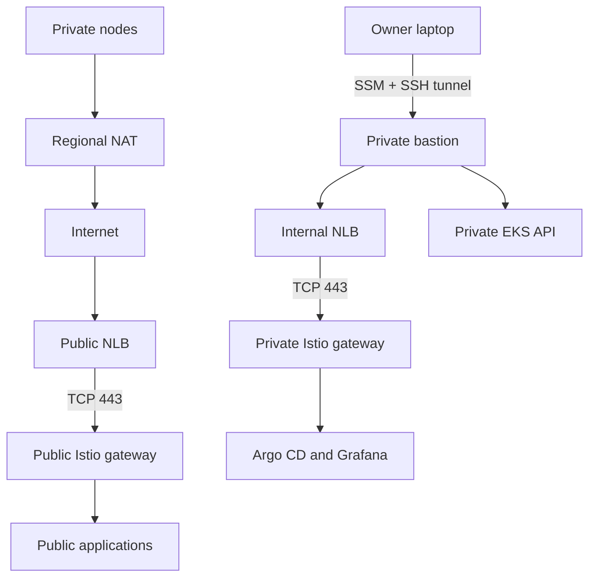
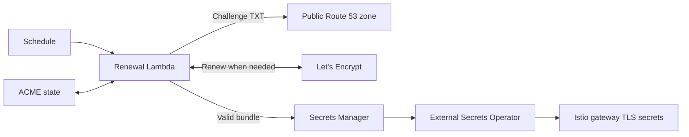
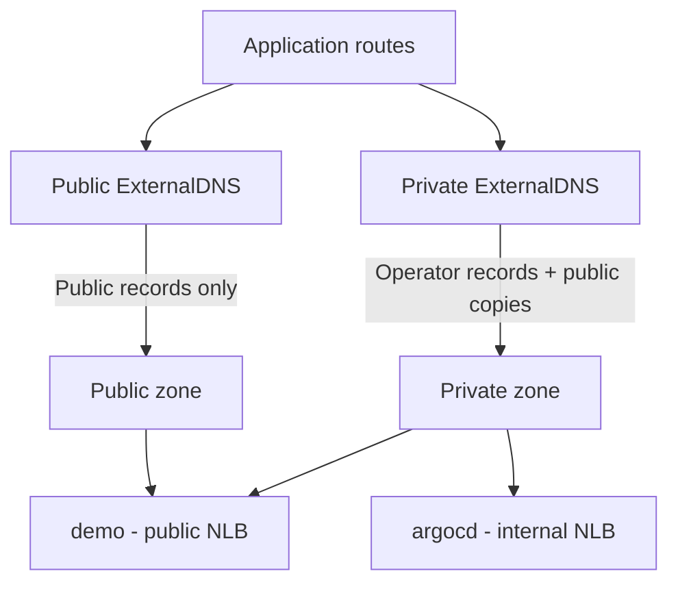

# Architecture

Target design and ownership for a private EKS platform in one AWS account and Region. Deployment values live in `platform/default.tfvars` and `platform/backend.s3.hcl`; the public zone is shown as `aws.example.com`. Decisions with alternatives are in [ADRs](docs/adr/); terms are in [CONTEXT.md](CONTEXT.md).

## Constraints

- One account and Region. Workloads span three availability zones while deployed.
- The platform is disposable: the owner deploys and destroys it from a local machine, with a budget of about USD 100 per month ([cost](docs/cost.md)). Workload data does not persist between deployment sessions.
- Terraform modules are written from provider resources; no registry or vendored modules ([ADR-0005](docs/adr/0005-build-terraform-modules-from-resources.md)).
- Environments differ by variable values, not copied Terraform trees. Secret values stay out of Git and tfvars; consumers reference AWS Secrets Manager.

## Implemented

The disposable root in `platform/` defines:

- **VPC**: three private `/20` and three public `/24` subnets across three AZs, no automatic public IPs, one regional NAT gateway for private egress, custom public/private NACLs for coarse subnet boundaries, a default security group with no rules, and VPC Flow Logs to CloudWatch with finite retention, deleted at teardown.
- **Bastion**: one AL2023 ARM64 instance in a private subnet with no public IP and no inbound rules. It has an encrypted gp3 root disk, IMDSv2, an SSM instance role, and cloud-init that installs only the owner's public SSH key. The AMI is resolved at creation; adopting a newer image is a deliberate replacement.
- **Access**: SSM, SSH over SSM, and `sshuttle` from local mise tasks. The tunnel routes only the VPC CIDR and forwards ordinary DNS (not DNS-over-HTTPS). See the [runbook](docs/runbooks/vpc-bastion.md).

State is in an existing S3 bucket with native locking, owned outside this root. Nothing else below is implemented.

## Ownership

Each resource has exactly one lifecycle owner. Terraform and Kubernetes controllers never manage the same AWS resource.

| Owner | Resources |
|---|---|
| Terraform shared foundation, `platform/shared/` (separate state) | ECR pull-through cache, public Route 53 zone and its delegation in the Cloudflare parent zone, certificate secret containers and IAM, renewal Lambda and schedule ([ADR-0006](docs/adr/0006-separate-shared-foundation-lifecycle.md)) |
| Terraform disposable root, `platform/` | VPC, bastion, EKS and managed add-on selection, system node group, Argo CD and Karpenter bootstrap, baseline NodePool and EC2NodeClass ([ADR-0007](docs/adr/0007-bootstrap-argocd-and-karpenter-with-terraform.md)) |
| GitOps, `gitops/` | Istio, ExternalDNS, External Secrets Operator, policy, workloads |
| Kubernetes controllers | AWS resources they provision, such as load balancers and EBS volumes |
| External ACME renewal | ACME state, DNS-01 challenge records, the published certificate bundle ([ADR-0008](docs/adr/0008-retain-acme-certificates-outside-eks.md)) |
| AWS EKS managed add-ons | Operation of selected components; AWS-owned regional ECR images are allowed |
| Networking account (optional) | A shared transit gateway, its routing, and attachment acceptance |
| Owner's machine | Deployment and teardown |

## Network and access

- EKS nodes have no public addresses and the Kubernetes API is private.
- Public applications use a public NLB; Argo CD and Grafana use a separate internal NLB and private DNS, reached through the bastion, and also require application authentication. Both NLBs pass TCP through to Istio gateways, where Envoy terminates TLS. Moving TLS termination to an AWS listener requires a new decision.
- Private egress uses the regional NAT gateway with open internet egress initially; destination allowlisting is deferred.
- Images come through the account's ECR pull-through cache where supported, with explicit mirroring otherwise. The cache reduces, but does not eliminate, upstream pulls.
- An optional transit-gateway attachment to a separate networking account is a future integration; standalone operation must not depend on it. The networking owner controls sharing, acceptance, and TGW routes; this platform controls its attachment and VPC routes. An attachment or a route in one account does not prove end-to-end connectivity. VPC and Kubernetes service CIDRs use RFC 1918 space, exclude `100.64.0.0/10`, and must not overlap local or connected networks.

## Bootstrap

1. Terraform creates the network and cluster; a separate Ansible stage is added only if needed.
2. Private connectivity is established through the bastion.
3. Terraform installs Argo CD and Karpenter, passes them infrastructure-derived configuration directly, and owns the baseline NodePool and EC2NodeClass. Custom resources are applied only after their CRDs exist.
4. Argo CD reconciles everything else from `gitops/`. GitOps never manages the Terraform-owned controllers or objects.

One managed system node outside Karpenter hosts both controllers, with one Karpenter replica and non-HA Argo CD settings; required node selection keeps them off workload nodes. This accepts a single-node failure boundary. External Secrets Operator delivers the ingress certificate bundle ([ADR-0008](docs/adr/0008-retain-acme-certificates-outside-eks.md)) and remains a candidate for workload credentials; it never carries bootstrap values.

## Certificates and DNS

Istio is installed through GitOps in one cluster, keeping a path to a later multi-region mesh (which needs disjoint addresses, inter-cluster routing, east-west gateways, and a shared trust model). Mesh workload identity is separate from ingress TLS.

Ingress certificates survive cluster teardown. A scheduled Lambda in the shared foundation, outside the VPC, keeps the ACME account and renewal state, renews through DNS-01 against the public zone only when needed, and publishes only a validated bundle to Secrets Manager. External Secrets Operator copies the bundle into each new cluster; no cert-manager is needed. A failed renewal must keep the last valid bundle; renewal failures and approaching expiry are monitored. Terraform creates containers, IAM, and the runner; only runtime code writes secret values.

DNS is split-view on one name, `aws.example.com`:

- Cloudflare keeps the parent zone. Terraform owns the Route 53 public child zone and only its delegation records. A VPC-associated private zone with the same name has no public delegation.
- One wildcard certificate, `*.aws.example.com`, covers single-level names such as `demo`, `argocd`, and `grafana`. It does not cover the apex or deeper names, and it is delivered only to the two gateways; a leaked key affects the whole namespace.
- ExternalDNS, installed through GitOps, creates explicit records. Separate public and private instances use zone-scoped identities, source filters, and distinct TXT ownership IDs. The public zone holds only public application records. Route 53 does not fall back from a private zone to the public one, so the private zone holds operator records plus copies of public records.
- Application records are removed while ExternalDNS still runs, before ingress resources or the cluster are deleted.

## Security controls

- Security groups own resource-level paths: public HTTPS to the public NLB; the bastion to the internal NLB and the private API; application and health-check ports from the matching load balancer. EKS control-plane, node, DNS, and webhook traffic must keep working.
- NACLs are coarse and stateless, so they allow return traffic and ephemeral ports. They are not pod isolation; that belongs to security groups and Kubernetes NetworkPolicies. Neither filters AmazonProvidedDNS.
- The EKS-created cluster security group is AWS-managed and is not hardened by removing rules.
- Node metadata limits, encrypted volumes, workload IAM, operator authentication, and pod policy arrive with their resources. Extra inspection services need a stated threat and cost.

These are controls to verify, not deployed guarantees. The [plan policy](scripts/plan_policy.py) enforces a subset before apply (internet ingress, public IPs, IMDSv2, root-volume encryption, admin policies), and `mise run verify-live` checks the deployment.

## Open for implementation plans

Implementation plans settle versions, IAM bindings, application authentication, mesh mode and trust, sizing, log retention, the root GitOps application, and CRD ordering. Each plan prices its topology and defines acceptance evidence: workload availability, least-privilege identities, network isolation, encrypted storage, secret access, logging, upgrade and recovery, and teardown cleanup (including what persists: state, logs, snapshots, volumes).

Required checks are credential-free. Live checks are explicitly selected, read-only pytest suites; see [tests/README.md](tests/README.md).
