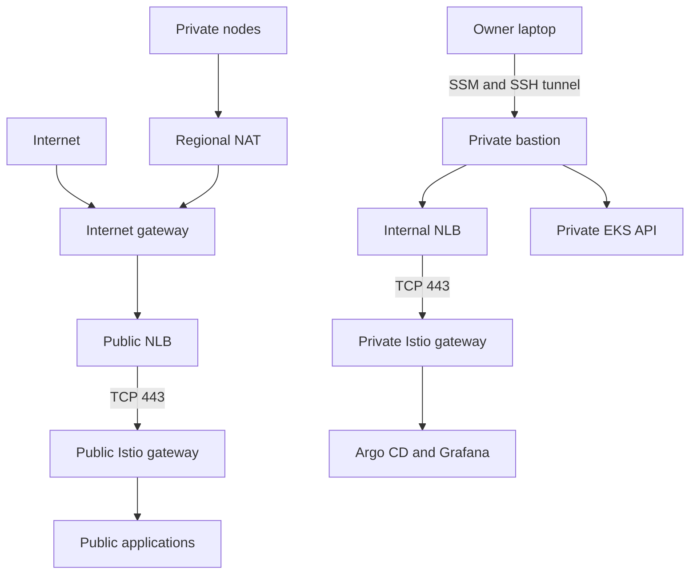
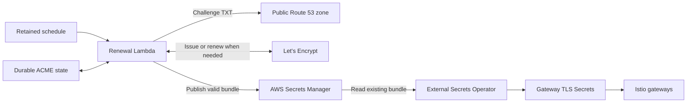
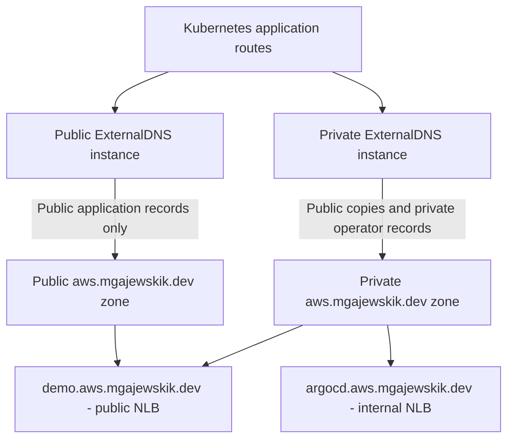

# Architecture

This records the implemented VPC and bastion plus the target ownership map. Nothing has been deployed. Workflow rules live in [AGENTS.md](AGENTS.md); terms live in [CONTEXT.md](CONTEXT.md).

**Architecture accepted:** 2026-09-27. The owner confirmed Q17 and closed the architecture interview. Implementation will use separate tasks and staged plans; this document does not authorize deployment or claim that resources exist.

## Current implementation

The disposable `platform/` root now defines a VPC and one private bastion in account `220263133738`, Region `eu-north-1`. It uses the existing, separately owned S3 state bucket `terraform-state-220263133738`, key `eks-platform/platform/terraform.tfstate`, native S3 locking, and non-secret `platform/default.tfvars`. Backend bucket Region and controls still need owner verification before initialization. No Terraform workspaces or GitOps manifests are implemented. No AWS resources have been deployed.

The VPC uses `10.80.0.0/16`, with private `/20` subnets and public `/24` subnets in `eu-north-1a/b/c`. Public subnets do not auto-assign public IPs. One regional NAT serves outbound private routes; actual active AZ coverage needs a live check. Custom public/private NACLs enforce coarse subnet boundaries, while resource security groups own narrower access. The unused default security group has no rules. Terraform creates CloudWatch VPC Flow Logs with seven-day retention and deletes their log group on platform teardown.

The AL2023 ARM64 `t4g.medium` bastion sits in the `eu-north-1a` private subnet, with no public IP or inbound security-group rules. Its encrypted 8 GiB gp3 root disk, IMDSv2 requirement, SSM instance role, and cloud-init SSH setup are defined in Terraform. Cloud-init adds only the owner's public key; `~/.ssh/aws-eks-platform` stays on the laptop. Image or configuration changes replace this single instance and interrupt access. Cloud-init completion, SSM/SSH readiness, and tunnel capacity still need live checks.

The owner starts SSM, SSH over SSM, and sshuttle from local mise tasks. Application traffic through sshuttle is limited to `10.80.0.0/16`; `--dns` temporarily forwards ordinary laptop DNS queries through the bastion to VPC DNS. This does not capture DNS-over-HTTPS. Ctrl+C ends the tunnel. See the [runbook](docs/runbooks/vpc-bastion.md) for live validation and cleanup.

## Target and ownership

The platform runs in one AWS account in Stockholm, `eu-north-1`. It must support workloads across availability zones while deployed. Deployment and teardown are local, owner-run operations. The monthly experiment target is approximately USD 100, with flexibility and a preference for lower cost. The owner destroys the platform between experiments. Affordable runtime depends on the eventual topology and retained resources.

Terraform modules are authored from provider resource blocks in this repository. External and vendored prebuilt Terraform modules are excluded so the owner can learn each module's internals. See [ADR-0005](docs/adr/0005-build-terraform-modules-from-resources.md).

An optional connection can attach the platform VPC to a transit gateway owned by a separate networking account. Standalone operation must not require that account. The networking owner controls sharing, attachment acceptance where required, and transit-gateway routing; the platform owner controls its VPC attachment and VPC routes. Neither attachment existence nor a route in one account proves end-to-end connectivity. See [AWS transit gateway sharing](https://docs.aws.amazon.com/vpc/latest/tgw/working-with-transit-gateways.html).

| Owner | Resources and configuration |
|---|---|
| Terraform shared foundation in `platform/shared/` | Retained ECR cache configuration, public Route 53 zone, Cloudflare delegation, certificate secret containers/IAM, and renewal Lambda and schedule; separate state, no secret values |
| Disposable Terraform roots under `platform/` | VPC, EKS configuration and managed add-on selection, system node group, Argo CD/Karpenter bootstrap, and baseline Karpenter NodePool/EC2NodeClass |
| GitOps YAML in `gitops/` | Remaining cluster software, including Istio, ExternalDNS, and External Secrets Operator; workloads, policy, and resource requests after bootstrap |
| External ACME renewal workflow | Retained ACME state, DNS-01 challenges, and published certificate/key bundle; independent of EKS |
| AWS EKS managed add-ons | Operation of selected managed components; AWS-owned regional ECR images are allowed |
| Kubernetes controllers | AWS resources provisioned from those requests, such as load balancers and EBS volumes |
| Networking account | Shared transit gateway and its routing/acceptance policy |
| Owner's local machine | Deployment, teardown, explicitly selected live scenarios |

Terraform and controllers must never manage the same AWS resource. An Ingress or PVC can request a controller-owned resource while Terraform owns the cluster and controller identity. See [ALB integration](https://docs.aws.amazon.com/eks/latest/userguide/alb-ingress.html) and [EBS CSI](https://docs.aws.amazon.com/eks/latest/userguide/ebs-csi.html).

Environment differences use variable values rather than copied Terraform trees. Secret values stay outside Git and tfvars; cluster consumers reference secrets through the chosen AWS integration.

## Foundation decisions from the design interview

The agreed network has three private workload subnets and three public ingress subnets across three AZs. EKS nodes have no public addresses, and the Kubernetes API is private. A public application demonstrates internet connectivity through a public load balancer. Argo CD and Grafana use a separate internal load balancer and private DNS, reached through the bastion connection. Private UI access also requires application authentication. The owner accepted separate public and internal NLBs with TCP passthrough to Istio gateways, replacing the earlier ALB proposal. TLS terminates at Envoy under this design; moving termination to a managed AWS listener would require an explicit design change.

Regional NAT Gateway is the outbound path, with internet egress allowed initially. Destination allowlisting is deferred. Public application ingress uses a separate load-balancer path. Administrative access must support the owner's laptop reaching private addresses and resolving private names through a bastion. The selected design uses SSM with SSH and sshuttle, subject to an integration test. Private subnet placement and NAT alone do not establish access control.

Future TGW attachment is a theoretical integration target with no assigned organization address range. Use RFC 1918 address space and exclude CGNAT space, `100.64.0.0/10`. The final VPC and Kubernetes service CIDRs must also avoid local and future connected-network overlap. Avoiding CGNAT alone is not proof against routing conflicts.

Third-party platform and application images use the account's ECR cache where supported, with explicit mirroring for unsupported sources if needed. AWS-managed EKS add-ons may use AWS-owned regional ECR repositories. The cache reduces upstream downloads; it does not guarantee that first imports or refreshes avoid upstream limits.

Cloudflare retains the `mgajewskik.dev` parent zone. Route 53 hosts the reusable public child zone `aws.mgajewskik.dev`. The shared Terraform root uses AWS and Cloudflare providers to manage that child zone and only its delegation records in the existing parent. A separate VPC-associated private zone supplies operator names and has no public NS delegation. The accepted single-wildcard design replaces the earlier `internal.aws.mgajewskik.dev` suffix with single-level names and a same-name private zone.

ExternalDNS is required and installed through GitOps. It owns application DNS records requested through the selected Kubernetes ingress or route API. Terraform owns zones and delegation. Certificate validation records belong to their issuer workflow. Public and private reconciliation use distinct zone-scoped identities, source filters, and TXT ownership. Remove application records while the controller still runs before deleting ingress resources or the cluster. Exact controller versions and source APIs belong to the implementation plan.

The future shared foundation in `platform/shared/` will use independent Terraform state so ECR caches and public DNS can survive platform teardown. The disposable root and its backend configuration are implemented; the state bucket is an existing user-supplied prerequisite whose Region and controls have not been inspected. The VPC-associated private zone and workload records have separate lifecycle requirements from the shared public zone. No shared root or private zone is implemented yet. See [ADR-0006](docs/adr/0006-separate-shared-foundation-lifecycle.md).

Workload data is disposable. The owner selected a clean slate for each experiment rather than retaining application volumes or restoring application state. Shared foundation and state-backend retention remain unchanged. Certificate and ACME account state now explicitly persist outside the cluster. VPC Flow Logs retain seven days while deployed; the disposable log group is removed at teardown. Later diagnostic-log policies remain open.

The accepted deployment sequence is Terraform foundation, a separate Ansible configuration stage if needed, establishment of private connectivity, Terraform bootstrap of Argo CD and Karpenter, and GitOps reconciliation of the remaining software. Terraform supplies infrastructure-derived controller configuration directly and owns the baseline NodePool and EC2NodeClass. Both controllers use one initial managed system node outside Karpenter's lifecycle, with one Karpenter replica and compatible non-HA Argo CD settings. Required node selection keeps them off workload nodes. This accepts a single-node failure boundary. External Secrets Operator is under consideration for runtime credentials, not controller bootstrap values. Exact provider versions, CRD ordering, and recovery steps must be settled before their implementation. See [ADR-0007](docs/adr/0007-bootstrap-argocd-and-karpenter-with-terraform.md).

## Ingress target

This diagram shows the accepted future topology, not a deployed network. The VPC and bastion are implemented in Terraform; EKS nodes, gateways, load balancers, and applications are not. Three public subnets can host future public ingress across the three AZs. Private subnets can host nodes, private gateways, and internal ingress. The regional NAT is an outbound service, not an inbound gateway or a resource hosted in one public subnet.

Envoy terminates client TLS at each gateway. One managed system node hosts Argo CD and Karpenter independently of Karpenter-managed workload nodes. A future transit-gateway attachment is outside this initial topology.

## Istio and retained certificates

Istio and its Envoy proxies are required learning capabilities, installed through GitOps. Begin with one cluster in Stockholm, while preserving a path to later meshed multi-region clusters. A second Region and cross-region connectivity are not part of the first implementation. The future design needs explicit inter-cluster routing, disjoint addresses, east-west gateways where required, and a workload identity trust model.

The owner accepted retained Let's Encrypt certificates, AWS Secrets Manager storage for published TLS bundles, and External Secrets Operator delivery into each replacement cluster. No in-cluster cert-manager is needed for this ingress path. The external issuer retains ACME account and renewal state and issues only when needed. ESO reads the current bundle; it does not request certificates. Mesh workload identity and automatic rotation remain separate. See [ADR-0008](docs/adr/0008-retain-acme-certificates-outside-eks.md).

The accepted renewal runner is a scheduled Lambda outside the disposable VPC, retained with the shared foundation. It must recover durable state, check renewal eligibility, complete DNS-01 against the public Route 53 zone, and publish only a validated certificate/key bundle. A schedule invocation is a renewal check, not a new certificate order. The exact ACME client, state format, retry handling, and timeout behavior require a staging proof in the implementation task.

Terraform creates containers, permissions, and the runner infrastructure; runtime code writes secret values. Certificate state and renewal survive EKS teardown. The runner needs failure and expiry monitoring and must preserve the last valid bundle on failure.

## One wildcard and split-view DNS

One `*.aws.mgajewskik.dev` certificate covers `demo.aws.mgajewskik.dev`, `argocd.aws.mgajewskik.dev`, and `grafana.aws.mgajewskik.dev`. It does not cover the zone apex or `argocd.internal.aws.mgajewskik.dev`. A wildcard certificate does not require a wildcard DNS record; create explicit application records through ExternalDNS.

The public and private hosted zones both use `aws.mgajewskik.dev`. Public DNS contains only public application addresses. The private view contains private operator addresses and copies of public application records needed from the VPC. Route 53 does not fall back to the public zone when a matching private zone lacks a record, so these copies are required. [Route 53 split-view behavior](https://docs.aws.amazon.com/Route53/latest/DeveloperGuide/hosted-zone-private-considerations.html).

Use explicit public/private resource selection, zone IDs, scoped identities, and distinct TXT ownership IDs. A hostname suffix cannot distinguish visibility in this model. Verify that operator names have no public application records. The same wildcard key is delivered only to the two gateways; compromise of either copy affects the whole wildcard namespace. The owner accepted flat names, split-view DNS, and scheduled Lambda renewal in Q17.

## Security design and implementation checks

Security groups enforce resource-level paths: public HTTPS to the public load balancer, bastion access to the internal load balancer and private API, and target application and health-check ports from the corresponding load balancer. The selected load-balancer type will determine the exact source and health-check rules. The SSM bastion has no public address or inbound SSH rule. Required EKS control-plane, node, DNS, and webhook traffic must remain functional.

Custom NACLs provide coarse public/private subnet boundaries. They are stateless, so their rules must include return traffic and the ephemeral ports required by the load balancers and NAT. Fine-grained workload isolation belongs in security groups and later Kubernetes NetworkPolicies. Do not treat an allow-VPC NACL as proof of pod isolation or claim that SGs and NACLs filter AmazonProvidedDNS.

The proposed first VPC baseline disables automatic public addressing, leaves the VPC default security group unused with no rules, and enables VPC Flow Logs with finite retention. The EKS-created cluster security group is a different resource with AWS-managed behavior; do not promise to remove rules that EKS recreates. Node metadata restrictions, encrypted disks, workload IAM, operator authentication, and pod policy enter with their respective resources. Additional inspection services need a stated threat and cost decision rather than automatic inclusion.

These are controls to validate, not a claim of complete security. The foundation plan records the traffic matrix, denial checks, and outstanding TLS and identity choices.

See the [architecture plan](docs/plans/2026-09-27-private-eks-foundation.md) and [primary-source research](docs/research/2026-09-27-private-eks-foundation.md) for accepted decisions, evidence, and work assigned to implementation stages. These are architecture targets, not deployed capabilities.

## Follow-up implementation plans

The owner closed this architecture task and assigned implementation to separate plans. Those plans must settle exact provider/chart/client versions, IAM principal bindings and application authentication, mesh mode and trust lifecycle, resource sizing, log retention, deployment commands, and validation. These details are intentionally deferred; they do not reopen this architecture interview.

The first platform plan must define AZ/node capacity, private API access from the local runner, egress, state/bootstrap ownership, GitOps reconciliation, and policy enforcement. It must price these choices before promising affordable uptime.

The acceptance criteria need observable workload availability, least-privilege identities, network isolation, encrypted storage, secret access, logging, upgrade/recovery procedures, and cleanup outcomes. "Production ready" is not a substitute for those checks. Regular teardown also needs a rule for what persists, including state, logs, snapshots, and volumes.

Terraform owns the Argo CD and Karpenter installations and baseline EC2NodeClass/NodePool throughout their lifecycle. The bootstrap plan must define the root GitOps application, system-node capacity, and CRD/custom-resource ordering. Terraform and GitOps must not manage the same objects concurrently.

## Verification boundary

All tests use Python/pytest and uv-managed dependencies. Required checks are credential-free and do not access a live cluster. Future read-only tests inspect a manually deployed platform. Separate user-run scenarios prove policy behavior and ALB/EBS provisioning and cleanup.

See [the testing strategy](docs/research/2026-09-27-eks-testing-strategy.md) and [test execution contract](tests/README.md). Cross-account networking and availability claims require live evidence when those capabilities are implemented.
