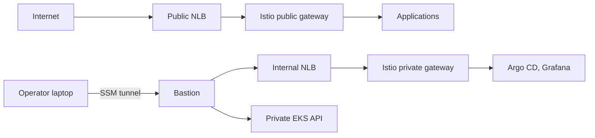

# AWS EKS Platform

[](https://github.com/mgajewskik/aws-eks-platform/actions/workflows/checks.yml)

A reference architecture for a private, disposable Amazon EKS platform. Terraform owns the AWS foundation, GitOps owns cluster state, and every resource has one lifecycle owner. The platform is deployed from a local machine and destroyed between sessions.

## Status

| Area | Status |
|---|---|
| VPC across three AZs, regional NAT, flow logs | Implemented |
| Private SSM bastion with SSH and VPN-style tunnel | Implemented |
| Credential-free checks: pytest, Terraform validate, TFLint, Trivy | Implemented, in CI |
| Policy-checked saved plans; read-only live checks | Implemented |
| Private EKS, Argo CD and Karpenter bootstrap | Designed ([ADR-0007](docs/adr/0007-bootstrap-argocd-and-karpenter-with-terraform.md)) |
| Istio ingress, split-view DNS, retained certificates | Designed ([ADR-0008](docs/adr/0008-retain-acme-certificates-outside-eks.md)) |
| Shared foundation: ECR cache, public zone | Designed ([ADR-0006](docs/adr/0006-separate-shared-foundation-lifecycle.md)) |
| GitOps manifests, policy, observability | Not started |

## Target design



Nodes and the Kubernetes API are private. Operator UIs are reachable only through the bastion. Details, ownership, and decisions are in [ARCHITECTURE.md](ARCHITECTURE.md) and [docs/adr/](docs/adr/).

## Quickstart

Requires [mise](https://mise.jdx.dev/). Commands assume mise is activated in your shell.

```bash
touch .env.local            # local-only settings and credentials; may stay empty
mise install
uv sync --locked
mise run checks             # no cloud credentials needed
pre-commit install          # fast checks before each commit
```

To deploy, set your values in `platform/default.tfvars` and `platform/backend.s3.hcl`, then follow the [bastion runbook](docs/runbooks/vpc-bastion.md). Check [cost](docs/cost.md) first: resources bill while deployed.

## Layout

| Path | Contents |
|---|---|
| `platform/` | Terraform root and modules, written from provider resources |
| `gitops/` | Cluster desired state (planned) |
| `tests/` | Pytest suites; see [tests/README.md](tests/README.md) |
| `docs/` | ADRs, runbooks, plans, cost estimate |
| `AGENTS.md`, `.agents/skills/` | Rules and skills for AI coding agents |
