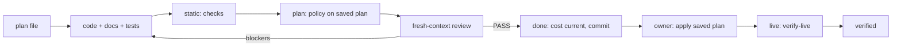

# Agent harness

[AGENTS.md](../../AGENTS.md) holds the rules. This guide shows how the pieces fit and where they are heading.

## Loop

- **Plan**: `planner` writes `docs/plans/YYYY-MM-DD-<slug>.md` from the [template](../plans/TEMPLATE.md). Workstreams let parallel subagents each take one slice; Progress lets a new session resume. The plan is committed with the change for audit.
- **Static**: `mise run checks` is the same command locally and in CI and needs no credentials. Pre-commit runs its fast subset before every commit.
- **Plan tier**: `mise run plan` saves `platform/tfplan` only when [the plan policy](../../scripts/plan_policy.py) passes; `mise run apply` applies exactly that file, and Terraform refuses it once state has moved on ([ADR-0009](../adr/0009-apply-only-a-policy-checked-saved-plan.md)). Teardown passes the same gate with `mise run plan -- -destroy`.
- **Review**: one fresh-context reviewer checks Spec and Standards and reports; it does not fix. The `reviewer` skill is for explicitly requested branch or ref reviews.
- **Live**: after apply, `mise run verify-live`, read-only. A destroy is complete when apply reports every planned resource destroyed; Terraform state cannot see controller-owned resources, which get their own check with the first controller (AGENTS.md).

## What each check catches

| Check | Catches |
|---|---|
| Trivy, TFLint, validate | Insecure or invalid source |
| Plan policy | Resolved values that break an invariant (internet ingress, public IPs, IMDSv1, unencrypted root volumes, logs kept forever, admin policies, missing `Project` tag) and deletion of retained data. Inline scanner ignores do not apply. |
| No-drift plan in `verify-live` | Changes made outside Terraform to managed attributes |
| Live behavior | SSM registration and NAT egress, flow-log delivery, rules added outside Terraform |
| Controller leftover check (planned) | Load balancers, volumes, and records a controller created and destroy left behind |

## Path to autonomy

The goal is for agents to deploy, verify, and tear down without the owner, so experiments are cheap. Apply stays owner-run until each step holds:

1. The plan policy covers every resource type the platform creates.
2. `verify-live` and the controller leftover check pass across several owner-run sessions without false failures.
3. Agent permissions deny direct AWS and `kubectl` mutation and allow only `mise run apply` of a saved plan; an AWS budget alarm caps spend.
4. The owner grants autonomy in AGENTS.md, scoped to the platform account.

## Agent access

Agent sessions run in the Claude Code sandbox, which hides `~/.aws` and `~/.ssh` and blocks the Unix sockets Terraform providers and TFLint plugins need. The committed [`.claude/settings.json`](../../.claude/settings.json) opens only what the read-only tiers need:

| Setting | Effect |
|---|---|
| `env.AWS_PROFILE = eks-platform-agent` | Every AWS call in the session uses the read-only role, including commands the owner starts with `!` |
| `sandbox.excludedCommands` | `mise run checks`, `mise run plan`, and `mise run verify-live` run outside the sandbox, listed also in the `rtk`-rewritten form the shell hook produces |

Exclusions match the exact command text. `mise run plan -- -destroy`, `mise run apply`, and any compound command stay sandboxed and fail without credentials. Agents cannot run ad hoc `aws`, `terraform`, `tflint`, or `kubectl`, or the bastion access tasks.

The read-only role is a one-time owner prerequisite outside `platform/`, like the state bucket:

- Role `eks-platform-agent-read`, trusted by principals in the platform account, with the AWS managed `ReadOnlyAccess` policy.
- Inline allow: `s3:PutObject` and `s3:DeleteObject` on the state key's `.tflock` object only, for plan's lock.
- Inline deny: `secretsmanager:GetSecretValue`, `secretsmanager:BatchGetSecretValue`, `kms:Decrypt`, and `ssm:GetParameter*` on the account's own parameters. Public AWS parameters such as AMI IDs stay readable. The `kms:Decrypt` deny assumes a state bucket encrypted with S3-managed keys; a KMS-encrypted bucket needs a decrypt allow for that key.
- Profile `eks-platform-agent` in `~/.aws/config` with the role's `role_arn` and the owner's login as `source_profile`. The CLI and Terraform assume it automatically, one hour at a time; no agent keys exist.

The owner applies from their own terminal, where the project settings do not apply; inside the session, `mise run apply` stays sandboxed and fails.

Limit: excluded commands run unsandboxed and can read all of `~/.aws`. The role guards against mistakes, not against an agent that rewrites the task scripts. Autonomous runs need an environment that holds only agent credentials.

## Skill provenance

Codex discovers skills in `.agents/skills/`; Claude Code discovers them through the `.claude/skills` symlink. `planner` and `reviewer` started as copies of the owner's global `plan` and `review` skills and are maintained here. `cost-audit` is repository-specific. Planning interviews use the global `grill-with-docs`, `grilling`, and `domain-modeling` skills, which are deliberately not copied.
