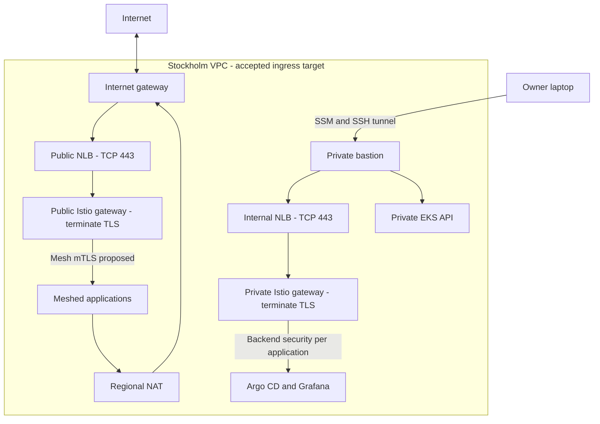
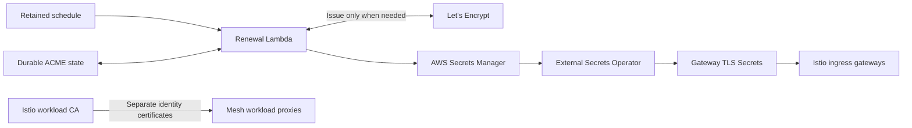

# Private EKS foundation architecture

**Status:** done
**Loop candidate:** no
**Date:** 2026-09-27

## Goal

Agree on a documented network and access architecture for a single-account EKS platform in Stockholm before writing Terraform. The first implementation slice will be Terraform setup and the VPC. EKS, image caching, DNS, and future organization connectivity constrain that foundation without becoming immediate implementation work.

The owner confirmed architecture agreement on 2026-09-27. This completed plan covers the architecture document and diagrams only. Implementation uses separate tasks and staged plans; no infrastructure work is authorized by this closure. Remaining implementation decisions are explicitly assigned below.

### Success criteria

- [x] C1: Topology names subnet roles, three-AZ coverage, ingress, egress, private API access, and ownership. Evidence: ARCHITECTURE.md ownership table and traffic diagram, supported by the research citations.
- [x] C2: Document the SSM/SSH bastion and sshuttle traffic/DNS paths, SSM and SSH authorization layers, separate EKS/application authorization, and denied public paths. Evidence: security traffic matrix and accepted private-access design. Exact IAM principals and application authentication are assigned to the access/bootstrap implementation plan.
- [x] C3: Define the ECR image-source policy and cache limits, Cloudflare delegation, and external TGW ownership. Evidence: architecture foundation decisions, ADR-0006, and research; detailed image inventory and cross-account integration are assigned to implementation stages.
- [x] C4: Bound the VPC implementation with a candidate CIDR table, Regional NAT provider-support research, existing backend prerequisites, and cost/runtime assumptions. Evidence: address allocation, .mise.toml, ADR-0005, and docs/cost.md. Exact provider pins, final overlap checks, backend inspection, and complete sizing/cost belong to the VPC implementation plan.
- [x] C5: Record explicit architecture agreement and update architecture, qualifying ADRs, and glossary. Evidence: the owner's acceptance and instruction to close architecture work, ARCHITECTURE.md, ADRs 0005-0008, and CONTEXT.md.
- [x] C6: Define retained/shared state, disposable foundation, Terraform-owned Argo CD/Karpenter and baseline custom resources, independent seed compute, managed add-ons, GitOps, and optional Ansible ownership. Evidence: ownership map and ADRs 0006-0008; each resource has one lifecycle owner.
- [x] C7: State SG/NACL roles, permitted/denied paths, return traffic, observability, and CGNAT exclusion. Evidence: security traffic matrix, CIDR table, and cited research. Exact rules and live isolation checks are assigned to implementation; no deployed-security claim is made.
- [x] C8: Separate ingress TLS from mesh identity and define retained Let's Encrypt state, DNS-01, scheduled Lambda renewal, Secrets Manager publication, and ESO delivery. Evidence: ADR-0008 and the architecture certificate diagram. Rebuilds reuse valid certificates; client packaging and staging proof belong to implementation.
- [x] C9: Terraform owns the baseline NodePool/EC2NodeClass and independent system-node capacity. The plan specifies hard placement for foundational controllers and the chosen node/replica count, without claiming immunity from failures or eviction. Verified against the owner's decisions, ADR-0007, and the chart constraints; deployment verification belongs to implementation.
- [x] C10: Define GitOps-owned ExternalDNS, public/private resource selection, zone-scoped identities, distinct TXT ownership, private copies of public records, and cleanup before controller teardown. Evidence: automatic DNS section and architecture DNS diagram. Exact resource API/selectors are assigned to implementation; delegation and challenge records retain separate owners.
- [x] C11: Keep accepted decisions consistent across architecture, ADR, glossary, and plan, with fenced Mermaid diagrams for ingress, retained certificates, and split-view DNS. Evidence: scoped document inspection and local diagram rendering. GitHub rendering itself is not claimed.

### Anti-criteria

- [x] A1: No infrastructure implementation, account API calls, deployment, dependency installation, or external mutation. Evidence: documentation-only task diff, tool history, and empty Terraform entrypoint.
- [x] A2: No public API/nodes, inbound NAT path, or unsupported single-subnet ALB design. Evidence: final topology and denied-path matrix.
- [x] A3: No single-AZ-charge promise for Regional NAT, unlimited upstream-cache claim, or automatic SSM DNS claim. Evidence: explicit research caveats and integration checks.
- [x] A4: No ownership of the external TGW or unrelated Cloudflare parent records. Evidence: architecture ownership and ADR-0006; standalone operation remains independent.
- [x] A5: No claim of deployment or proven security. Evidence: current-implementation and verification sections, unchanged infrastructure files.
- [x] A6: No prebuilt Terraform modules or public operator UI. Evidence: ADR-0005 and private ingress design; no infrastructure implementation.
- [x] A7: No ESO-to-Helm handoff assumption, zero-configuration Karpenter claim, or NACL guarantee without return-path checks. Evidence: bootstrap and security contracts.
- [x] A8: No changed NLB TCP/Envoy TLS boundary, second Region, public private-app validation endpoint, or ALB TLS-passthrough claim. Evidence: diagrams and research alternatives.
- [x] A9: No implicit workload persistence, unlimited issuance, or Karpenter-only foundational compute. Evidence: explicit certificate-retention exception and independent system-node decision.
- [x] A10: No keys in Git/state, Cloudflare-origin browser-trust claim, or public operator DNS/competing record owner. Evidence: issuer/ESO and ExternalDNS ownership contracts; documentation contains no key material.
- [x] A11: No deeper/apex wildcard coverage, public-DNS fallback, or durable Lambda /tmp claim. Evidence: stated limits; Lambda and flat names were accepted explicitly.

## Context & References

- `ARCHITECTURE.md`: current target ownership and optional transit-gateway integration.
- `CONTEXT.md`: existing platform and networking-account terminology.
- `README.md`, `docs/dev/harness.md`, and `docs/plans/TEMPLATE.md`: planning and completion workflow.
- `.mise.toml`: Terraform 1.16.1 is pinned. No provider version or module implementation exists in the empty `platform/main.tf`. Ansible and sshuttle versions are not pinned in this project.
- `docs/cost.md`: existing USD 100 monthly budget target, regular teardown, no priced platform topology.

## Decisions

User-provided requirements:

- Use Stockholm, `eu-north-1`, and one platform account.
- Start with Terraform setup and a VPC module after architecture agreement. All modules are authored from scratch in this repository using provider resource blocks; external modules and vendored prebuilt modules are excluded. This is accepted in ADR-0005.
- Place three private workload subnets across three AZs. Keep EKS nodes and its API private.
- Prefer an actual Regional NAT Gateway over three separately managed zonal NAT gateways.
- Use three public subnets across the three AZs for public application ingress. The owner accepted separate public and internal NLBs with TCP passthrough to Istio gateways. Keep Argo CD and Grafana behind the internal NLB with private DNS.
- Provide administrative access through a bastion or SSM, including laptop access to private addresses and private DNS.
- Pull third-party platform and application images through account-local ECR caching where supported. AWS-managed EKS add-ons may use AWS-owned regional ECR images. Organization-wide centralization is future context.
- Keep `example.com` managed by Cloudflare and delegate `aws.example.com` to Route 53. Use the Cloudflare Terraform provider for the parent NS records, without adopting unrelated parent records.
- Preserve the option to attach to an externally owned transit gateway without creating that gateway. This is theoretical, with no organization CIDR allocation to conform to. Exclude CGNAT `100.64.0.0/10`.
- Use the existing state bucket (named in `platform/backend.s3.hcl`), subject to later backend prerequisite checks. No bucket properties have been inspected.
- Research and interview first. Do not create infrastructure code yet.
- Retain an approximately USD 100 monthly budget, with flexibility and a preference for lower cost. Destroy the disposable platform between deployment sessions.
- Terraform installs the AWS platform, Argo CD, and Karpenter, including the baseline EC2NodeClass and NodePool. The owner explicitly selected Karpenter as foundational so Terraform can pass infrastructure-derived configuration directly. Remaining cluster software comes through GitOps, apart from approved AWS-managed add-ons. ADR-0007 records this ownership.
- Retain ECR and public DNS in a separate Terraform root and state. Name it `platform/shared/`, within the repository's Terraform boundary. ADR-0006 records the lifecycle decision. CloudFormation is not selected.
- Use a separate Ansible stage for bastion configuration if necessary, then establish private connectivity before Terraform bootstraps Argo CD. The owner accepted this sequence; Terraform Actions are not required.
- Permit internet egress through NAT initially. Destination allowlisting is deferred.
- Harden the platform with security groups, NACLs, and controls tied to explicit security outcomes. Define observable acceptance instead of claiming complete security.
- Start with one managed system node independently of Karpenter, one Karpenter replica, and compatible non-HA Argo CD settings. Require foundational controller placement on that node, accepting failure downtime while protecting it from Karpenter workload-node scale-down.
- Workload data does not persist between deployment sessions. Shared foundation/state retention remains as agreed; certificate and ACME state are now an explicit retention exception. Diagnostic-log handling remains open.
- Deploy Istio and its Envoy proxies through GitOps and keep a path to a later multi-region mesh. Start with the single Stockholm cluster; do not add a second Region in the first implementation.
- Retain Let's Encrypt certificate and ACME state outside EKS, publish the TLS bundle in Secrets Manager, and use GitOps-managed ESO to deliver it to replacement clusters. Paid ACM and Cloudflare certificate alternatives are not selected. ADR-0008 records the decision. The owner accepted one `*.aws.example.com` wildcard, single-level application names, split-view DNS, and scheduled Lambda renewal.
- Install ExternalDNS through GitOps so Kubernetes application declarations request their DNS records automatically.

The owner explicitly closed the architecture interview and assigned implementation to other tasks and stages. The following work is deferred rather than silently assumed or a blocker to architecture closure. No new implementation plans are created by this task.

| Separate implementation stage | Decisions and evidence it must supply |
|---|---|
| Terraform setup and VPC | Exact provider pins and Regional NAT schema; final CIDR overlap checks; existing state-bucket prerequisites; SG/NACL rules and return paths; flow-log retention; sizing and complete cost assumptions. |
| Shared account resources | ECR inventory/upstream access and retention; Cloudflare delegation; certificate client/runtime and durable state format; scheduled Lambda permissions, monitoring, retries, staging issuance and recovery proof. |
| Private access and EKS bootstrap | SSM/SSH identities, EKS access entries and RBAC, sshuttle DNS validation, optional Ansible configuration, node sizing, managed add-ons, Helm/CRD stages, and root GitOps application. |
| GitOps platform services | Istio mode and workload trust, Gateway/route API, ExternalDNS selectors and ownership IDs, ESO delivery, application authentication, network policy, and verified cleanup. |
| Multi-region or organization integration | Additional cluster/trust design, external TGW owner agreement, disjoint routes, cross-region connectivity, DNS, and live acceptance. |

Verified constraints, not accepted design decisions:

- Regional NAT is available in commercial AWS Regions, including Stockholm. It does not need a hosting public subnet. Its bill includes an hourly charge for each active AZ, rather than one hourly charge for the regional resource.
- An ALB requires subnets in at least two AZs and only serves targets in enabled AZs. The owner accepted three public subnets for ingress across all three AZs.
- The AWS provider supports Regional NAT. The earlier external VPC-module proposal was rejected in favor of repository-owned modules. Exact provider versions and route ownership remain to be pinned before implementation.
- NAT is an outbound path. Public application ingress and administrative access are separate paths.
- An account ID is an identifier, not a credential. The provided state bucket name does not need replacement merely because it contains the account ID. Ownership, region, encryption, versioning, public-access controls, and lock permissions remain unverified.

## Architecture impact

Current state: the repository has no implemented VPC or cluster. The diagrams show the accepted architecture target, including retained certificates, flat names, and Lambda renewal. Exact workload mesh mode and runtime configuration belong to separate implementation plans. Arrows show logical traffic paths, not every service hop. The architecture document also shows the accepted DNS record flow.

Terraform owns the VPC, system nodes, and bootstrap controllers. GitOps owns Istio and load-balancer requests; AWS Load Balancer Controller owns the resulting NLBs. Shared ECR and delegated public DNS remain outside disposable state. Optional future TGW connectivity is not shown or provisioned. Both diagrams rendered successfully with Mermaid CLI 11.17.0 and were visually inspected.

### Certificates and mesh boundaries

Accepted ingress uses TCP NLB listeners so the client TLS session reaches Envoy unchanged. The owner accepted retained Let's Encrypt certificates and Secrets Manager delivery through ESO, avoiding fresh production issuance for each rebuild. A scheduled Lambda is the accepted renewal runner. Application data remains disposable; certificate state persists.

Use DNS-01 in the public Route 53 zone for Let's Encrypt wildcard issuance. The runner owns challenge TXT records; ExternalDNS does not. Public application reachability is not needed for validation. Native ACM ACME, exportable ACM, and Cloudflare alternatives remain in the research history and are not selected.

Workload mTLS uses mesh identity certificates, not public ACME certificates. The first-cluster mesh mode is still open. A later multi-region, multi-network design needs shared workload trust, inter-cluster API reachability, east-west gateways, and explicit network/DNS routing. Do not imply that choosing an ingress load balancer establishes those capabilities.

Private keys, certificate chains, and required ACME account state survive independently of EKS. Terraform owns secret containers and permissions, never secret values. The renewal workflow writes the bundle; ESO has read-only access. Reuse does not remove expiry, revocation, changed-name, or normal renewal requirements. A certificate ARN alone cannot configure an Envoy TLS Secret. See ADR-0008.

The runner is an EventBridge-scheduled Lambda in the shared foundation, outside the disposable VPC, so it can reach public AWS/ACME endpoints without the platform NAT or laptop. Each invocation checks whether renewal is due. Lambda's 900-second execution limit and ephemeral `/tmp` require bounded DNS waits and durable client-state recovery. Choose a compact state format that fits Secrets Manager or a retained encrypted/versioned S3 object for multi-file client state; do not reuse the Terraform state bucket as an implicit ACME store. Client/runtime versions and packaging belong to the shared-resources implementation plan.

Prevent overlapping writers and repeated orders on retry. Persist successful renewal state before publishing; publish only a verified matching certificate/key and full chain. If publication fails after renewal, the next invocation must retry delivery even when renewal is no longer due. Keep the last valid bundle on failure, report errors, and monitor expiry. ESO must refresh the gateway Secrets and Envoy must serve the renewed certificate. Validate this sequence in ACME staging, including rebuild reuse and timeout/failure paths. No in-cluster cert-manager is required for ingress. A laptop runner remains the simpler fallback if Lambda packaging proves disproportionate.

One wildcard, `*.aws.example.com`, covers single-level names such as `demo.aws.example.com`, `argocd.aws.example.com`, and `grafana.aws.example.com`. It covers neither the apex nor `*.internal.aws.example.com`. Share its key only with the two gateway workloads; this increases the impact of compromise compared with separate certificates. Do not add a wildcard application DNS record.

### Automatic application DNS

GitOps installs ExternalDNS. The accepted single-wildcard design uses public and private hosted zones both named `aws.example.com`. Public reconciliation selects only explicitly public route resources. Private reconciliation writes private operator records and mirrors public application records needed inside the VPC. Missing private-zone records return NXDOMAIN rather than falling back to public DNS. The earlier private `internal.aws` suffix is not used.

Use separate controller instances with explicit zone IDs/types, resource filters, and scoped AWS identities. A common suffix alone cannot separate public and private records. TXT ownership IDs must be stable across a replacement cluster, distinct between instances, and never shared by simultaneously running clusters. Define each instance's selectors so no private route reaches the public zone and each private copy has one owner.

Prefer Kubernetes Gateway API route sources if that API is selected for Istio. Ingress and Istio-native sources are alternatives; choose sources for the actual objects rather than enabling all of them. ExternalDNS creates records, not hosted zones or registered domains. It does not issue certificates. Terraform retains ownership of delegation, and the certificate workflow owns validation records.

Use scoped TXT ownership and a deliberate sync/cleanup policy. Before teardown, remove application route declarations and let ExternalDNS remove their owned records while controllers still exist; verify the records are gone before deleting gateways and the cluster. Abrupt teardown can leave stale records in the retained public zone. DNS publication alone does not prove gateway health or valid TLS.

### System-node and manifest contract

Terraform provisions a managed node group outside Karpenter's lifecycle. Require a system-node label for Karpenter and all enabled Argo CD components; optional taints keep ordinary applications off that capacity. A toleration or preferred affinity alone is not a placement guarantee. Validate system DaemonSets and other foundational services against the selected labels and taints.

The owner selected one initial system node and one Karpenter replica, with Argo CD replica and anti-affinity settings that permit one-node operation. It is not HA. Karpenter cannot consolidate managed-node-group nodes, but failures, upgrades, node pressure, and owner actions can still disrupt them.

Prefer structured `kubernetes_manifest` objects with Terraform expressions for NodePool/EC2NodeClass. A decoded YAML template is also possible. Avoid generated YAML followed by untracked `kubectl apply`. Install CRDs first, then plan/apply custom resources after the live schema exists. The provider versions and selected chart must be pinned and validated during implementation.

### Proposed address allocation

Use IPv4 initially. A bounded read-only check of the current execution environment's routes found `192.168.1.0/24` and Docker ranges `172.17.0.0/16`, `172.18.0.0/16`, `172.20.0.0/16`, and `172.21.0.0/16`. The candidate below does not overlap those observed ranges or CGNAT. This is not proof about disconnected VPNs or future networks.

| Purpose | Candidate ranges |
|---|---|
| VPC | `10.80.0.0/16` |
| Private workload subnets in three AZs | `10.80.0.0/20`, `10.80.16.0/20`, `10.80.32.0/20` |
| Public ingress subnets in three AZs | `10.80.48.0/24`, `10.80.49.0/24`, `10.80.50.0/24` |
| Address space reserved for future TGW attachment subnets | `10.80.51.0/28`, `10.80.51.16/28`, `10.80.51.32/28`; do not create attachments now |
| Future EKS service CIDR | `10.81.0.0/16`, outside the VPC; confirm before cluster creation |

### Security scope and traffic contract

No deployed vulnerability or successful isolation test is claimed: no infrastructure exists in this checkout. The following design risks must be addressed when their resources are implemented.

| Path | Intended control and later observable check |
|---|---|
| Internet to public demo | Public NLB forwards TCP 443 to the public Istio gateway, which terminates TLS. Only the gateway target and health-check paths are allowed from the corresponding LB SG. |
| Internet to operator applications, nodes, bastion, or Kubernetes API | Private placement, disabled public API, no public instance addresses, and SG rules deny direct public access. An unconnected client cannot reach these services. |
| Owner to bastion | SSM authorization and SSH credentials establish the tunnel. Bastion SG has no inbound SSH rule. |
| Bastion to internal load balancer and EKS API | Allow selected HTTPS paths from the bastion SG, plus explicitly required administration. Private name resolution and authenticated connections succeed from the connected laptop. |
| Load balancers to gateway targets | Corresponding LB SG supplies target and health-check traffic. Health checks pass and unrelated clients cannot connect directly. Verify target client-IP preservation before finalizing NACL rules. |
| EKS control plane, nodes, DNS, and webhooks | Preserve required cluster communication; node readiness, API operations, DNS, admission webhooks, and pod traffic pass later live checks. Do not fight EKS-recreated cluster SG self rules. |
| Private resources to internet | NAT egress works with the declared initial policy. Private subnet NACLs include return traffic. No claim of destination filtering is made. |

Use custom public/private NACLs as coarse subnet controls, with VPC traffic and required return paths allowed. Load-balancer/NAT return traffic needs documented ephemeral ranges. Resource SGs provide finer restrictions. The implementation plan must enumerate the actual protocol and return-path matrix before applying NACL rules; broad VPC NACL allowance is not workload isolation. SGs and NACLs do not filter AmazonProvidedDNS. NLB security groups must be attached at creation. TCP passthrough moves application logging and layer-7 enforcement to Envoy; an NLB is not a direct AWS WAF attachment point.

The proposed VPC baseline disables automatic public IP allocation, clears and avoids the unused VPC default SG, and enables bounded-retention VPC Flow Logs. These do not establish IAM least privilege, encrypted storage, operator authentication, or Kubernetes pod policy by themselves. Add those controls with their resources. TLS details and retention duration are still open; paid inspection services are not implicitly authorized.

### Accepted controller ownership

The owner rejected the proposed GitOps Karpenter installation and chose Terraform-owned Argo CD and Karpenter bootstrap, including baseline EC2NodeClass/NodePool. Terraform creates the AWS prerequisites and supplies the cluster name, IAM configuration, and discovery settings directly. No secret-store or GitOps handoff is needed for those values. External Secrets Operator remains a candidate for workload credentials after its own AWS access is bootstrapped. It does not automatically supply Argo CD Helm values. CRD ordering remains an explicit phase boundary before implementing that slice.

## Workstreams

### WS-1: Research, interview, and record the architecture

**Delivers:** The agreed architecture document and diagrams, covering C1-C11 and A1-A11. Implementation plans are separate future tasks.
**Blocked by:** None. Architecture agreement, documentation checks, and independent review are complete.
**Seams:** Public ingress, private administration, registry pulls, DNS delegation, state access, and future transit-gateway routes.

- [x] Verify current primary-source constraints.
- [x] Run the decision interview and record answers, including explicit architecture closure.
- [x] Update architecture, Mermaid diagrams, resolved terms, and qualifying ADRs.
- [x] Confirm shared understanding and assign implementation details to separate staged plans.

## Validation

- Read current official sources and relevant module/provider source; distinguish documented support from deployed proof.
- Inspect the complete task diff against baseline `63a3703a0f6777d5a272a0db6c7a948ce206fdfb`; the working tree was clean at task start.
- Check every final C/A item against the agreed text and tool history. The owner explicitly assigned implementation details to separate plans; do not invent their answers or treat them as deployed evidence.
- Close this architecture-only task with local checks, the documentation gate, rendered diagrams, and independent review. Live implementation tests remain outside this task.

## Out of Scope

Terraform or GitOps code creation, cloud inspection or mutation, deployment, dependency installation, creation of the external transit gateway, migration of the Cloudflare parent zone, and a claim of complete security. No cost API refresh is authorized.

## Docs gate

- [x] Plan: evidence: docs/plans/2026-09-27-private-eks-foundation.md | Records accepted architecture, criterion evidence, architecture closure, and separate implementation stages.
- [x] Architecture: evidence: ARCHITECTURE.md | Records accepted ingress, retained certificates, Lambda renewal, and split-view DNS with Mermaid diagrams.
- [ ] Runbook: skip: No operator procedure is implemented during this architecture interview.
- [x] ADR: evidence: docs/adr/0008-retain-acme-certificates-outside-eks.md | Records accepted external Let's Encrypt retention and ESO delivery; ADRs 0005-0007 retain module, shared-state, and bootstrap decisions.
- [x] Glossary: evidence: CONTEXT.md | Defines retained certificate state and split-view DNS alongside platform and operator terminology.
- [ ] README: skip: Usage and implementation status are unchanged.

## Progress

- 2026-09-27: Final independent Spec and Standards review returned Decision: PASS with no blockers and confirmed that this architecture-only plan is ready to mark done. Recorded closure after the owner's explicit agreement. Implementation and live acceptance remain separate tasks. No infrastructure code, deployment, commit, or push was performed.

- 2026-09-27: The owner accepted the architecture and explicitly closed architecture work, assigning implementation to separate tasks and stages. Recorded single-level names, one wildcard, split-view DNS, and scheduled Lambda renewal as accepted across the architecture, ADR, and cost notes. Reconciled C1-C11 as documentation criteria with explicit evidence and assigned implementation details to named future stages; checked A1-A11 against the documentation-only scope. Required checks passed: 24 pytest tests, Terraform formatting, cached Trivy config and secret scans; Terraform validation/TFLint and GitOps checks skipped their empty inputs. The docs gate, nine-document link/whitespace check, and `git diff --check` passed. Two changed Mermaid diagrams rendered and passed visual inspection; the other three matched their previously inspected sources. GitHub rendering and live cloud behavior remain untested. Final independent closure review is in progress.

- 2026-09-27: Accepted retained Let's Encrypt state and Secrets Manager/ESO delivery in ADR-0008. Updated architecture, glossary, research, and cost assumptions. Added three architecture Mermaid fences and updated two plan diagrams using the current Mermaid skill's core syntax. All five rendered locally and passed visual inspection; GitHub rendering itself was not tested. Nine scoped Markdown files passed local-link and whitespace checks, `git diff --check` passed, and the empty Terraform entrypoint was preserved. The docs gate initially rejected historical journal wording containing its placeholder keyword; those notes were rephrased without changing the draft status, and the gate then passed. C9 and C11 are documented; Lambda and flat-name DNS remain proposals. A1-A11 were checked without finding a violation. Full infrastructure checks and live tests are outside this documentation update. Independent Spec and Standards review returned Decision: PASS with no blockers for this documentation update; it does not approve the unimplemented Lambda or complete the architecture interview.

- 2026-09-27: Accepted one managed system node and separate public/internal NLBs. Added ExternalDNS ownership and teardown requirements. Reopened certificate lifecycle to retain valid certificates across redeployments; verified native ACM ACME, Cloudflare trust boundaries, and external renewal/secret-delivery options. Read Stockholm public pricing and reused the empty-configuration cost cache without an Infracost call. Links and whitespace passed across eight scoped Markdown files; both diagrams rendered and passed visual inspection; source correspondence, price arithmetic, empty Terraform, and `git diff --check` passed. C1-C10 awaited full interview closure; A1-A10 showed no violation. No implementation or live validation occurred. Independent completion review was not required for that planning-only update. Architecture agreement still required certificate ownership and other open interview decisions.

- 2026-09-27: Recorded Terraform-owned baseline Karpenter resources, independent system-node placement, disposable workload data, and required Istio/Envoy and ACME automation. Researched NLB passthrough, DNS-01 validation with private DNS, mesh identity, CRD ordering, and fresh-issuance limits. Both diagrams rendered and passed visual inspection. Local validation passed for seven Markdown files: relative links, whitespace, and correspondence with both rendered diagram sources. `git diff --check` passed; the Terraform entrypoint remains empty. C1-C9 remain open until the interview closes. A1-A9 were checked without finding a violation. Full implementation checks and independent completion review are not required for this ongoing planning-only update; no executable configuration or live system changed.

- 2026-09-27: Read the current architecture, glossary, workflow, tool pins, and budget. Recorded the clean task-start baseline. Started primary-source research and the mandatory grill-with-docs interview.
- 2026-09-27: Verified Regional NAT behavior and billing, ALB subnet requirements, private access constraints, and account-ID guidance against primary sources. The interview remains open. Independent completion review is not required for these draft research notes; no implementation or safety rules changed.
- 2026-09-27: Recorded the user's round-one answers, ADR-0005, and private operator terminology. Updated ARCHITECTURE.md with settled requirements. Research confirms documented sshuttle DNS forwarding and provider-defined local Terraform Actions; neither integration is locally or remotely tested.
- 2026-09-27: Local validation passed for relative links and trailing whitespace in all five scoped Markdown files, including untracked files. `git diff --check` passed. Confirmed ADR-0005 is accepted, this plan is draft, and `platform/main.tf` remains empty. No cloud calls, dependencies, implementation changes, or completed-architecture claim were introduced. C1-C6 awaited full interview closure; A1-A6 were checked against this round's changes without finding a violation. This was planning documentation, so implementation checks and independent completion review had not run.
- 2026-09-27: Recorded accepted shared-state lifecycle and Cloudflare delegation in ADR-0006. Added the internal ALB, initial NAT egress, and CGNAT exclusion. A read-only local route check and address arithmetic verified that the proposed allocation avoids currently observed local ranges and has no internal overlap. No guarantee is made for inactive VPNs or future networks.
- 2026-09-27: The owner's follow-up selected Terraform-owned Karpenter alongside Argo CD. ADR-0007, architecture, and research now use that model. The prior GitOps/no-handoff proposal is not selected. Local links and whitespace checks passed across seven scoped Markdown files, including the new ADRs; `git diff --check` passed and Terraform remains empty. C1-C7 await final design agreement; A1-A7 show no violation in this round. Completion review is not required for this ongoing planning-only turn; no executable security or deployment configuration changed.

## Outcomes

The architecture document and diagrams are settled and this plan is complete. The owner accepted one wildcard, single-level public/private names, split-view DNS, and retained scheduled Lambda renewal with Secrets Manager/ESO delivery. C1-C11 passed as documentation criteria; A1-A11 show no violation. Required checks, the docs gate, local Mermaid validation, and independent review passed. Implementation choices, deployment, and live validation belong to separate tasks and staged plans. No infrastructure was created. The changes are ready for the owner to review and commit separately.
