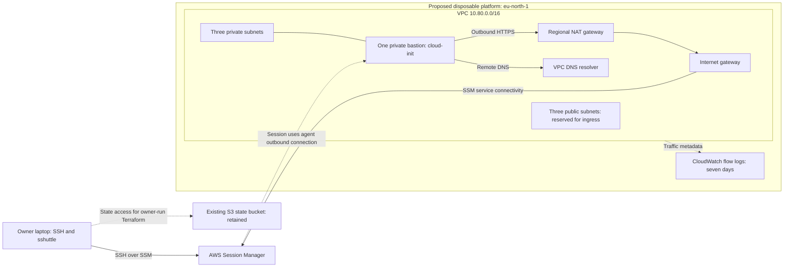

# VPC and SSM bastion

**Status:** done
**Loop candidate:** no
**Date:** 2026-09-27

## Goal

Implement the accepted network foundation and a private bastion, with owner-run deployment and laptop access through SSM, SSH, and sshuttle. This plan covers VPC and bastion modules and their local operator tooling, not EKS deployment.

### Success criteria

- [x] C1: Resource-authored VPC and bastion modules implement the accepted three-AZ IPv4 topology and agreed CIDRs in `eu-north-1`, including three public and three private subnets, regional NAT, custom NACLs, an unused default security group with no rules, and CloudWatch VPC Flow Logs with seven-day retention. Terraform owns and removes the log group during platform teardown. Verify Terraform validation, scoped policy tests, and independent review.
- [x] C2: One replaceable AL2023 ARM64 `t4g.medium` bastion has no public IP or inbound SSH rule, uses SSM, encrypted gp3 storage and IMDSv2 with hop limit 1, and receives its initial configuration and the owner's public SSH key through cloud-init. The private key remains on the laptop. Image or configuration changes use owner-run Terraform replacement, with accepted access downtime. Verify configuration checks and document owner-run SSM/SSH readiness and replacement probes, including available memory.
- [x] C3: The disposable root uses the existing state bucket (named in `platform/backend.s3.hcl`) with key `eks-platform/platform/terraform.tfstate`, S3 native state locking, explicit committed non-secret `default.tfvars`, and no Terraform workspaces. Backend settings remain separate from tfvars. Verify root/backend configuration and documented initialization commands; bucket region and controls must be established before deployment.
- [x] C4: Naming and supported tags identify `eks-platform`, with an optional prefix whose empty value introduces no leading separator. Verify `eks-platform-bastion` for an empty prefix and `dev-eks-platform-bastion` for `dev`, with `Project = eks-platform` on every taggable resource. AWS-generated resource IDs are not renameable. Enumerate untaggable resources in review rather than pretending every AWS resource supports tags.
- [x] C5: `pyproject.toml` describes repository tooling, sshuttle is a locked regular dependency, and pytest remains in the dev group. Verify manifest/lock consistency and command invocation without dependency installation during required checks.
- [x] C6: Mise exposes bastion connection and `vpn` tasks through readable Bash scripts with explicit target selection, useful failures, and documented prerequisites. SSH uses the laptop-owned `aws-eks-platform` key through SSM. The VPN forwards only the VPC CIDR for application traffic and uses `--dns` for ordinary laptop DNS while connected. Inspect invocation and guards, syntax-check the scripts, and document owner-run private TCP, DNS and tunnel-cleanup checks, including DNS-over-HTTPS limitations. Successful owner connectivity after deployment is the bastion acceptance test; do not maintain a bespoke bastion test suite.
- [x] C7: Required checks, documentation gate, scoped security review, and independent Spec/Standards review pass before implementation is reported ready. The runbook separates owner-run backend preflight, plan/apply, readiness, connectivity, and teardown verification, with expected signals and command safety disclosures. Live outcomes remain explicitly unverified until the owner supplies evidence.
- [x] C8: The AWS provider and connection tasks reject a deployment account other than the one in `platform/default.tfvars` and use `eu-north-1`. Use the existing AWS credential chain without a hardcoded profile. Verify account/region configuration and the connection script's identity checks before state access and session startup; never print credential environment variables.

### Anti-criteria

- [x] A1: Agents do not deploy, mutate cloud resources, start privileged networking, or claim live connectivity from offline checks. Verify command/evidence history.
- [x] A2: No private keys or other secret values enter Git, tfvars, cloud-init, or Terraform-managed secret payloads. Verify configuration and secret scanning.
- [x] A3: No unrelated EKS, shared-foundation, public DNS, TGW, or certificate resources are implemented, and the existing backend bucket is not created, imported, or managed. Verify the scoped resource inventory.
- [x] A4: VPN defaults do not capture unrelated application networks or detach a background tunnel. All ordinary DNS forwarding is explicit and limited to the foreground sshuttle session. Inspect arguments and document owner-run before/during/after cleanup checks; live cleanup remains unverified until the owner runs them. Never imply DNS-over-HTTPS is captured by `--dns`.
- [x] A5: Required checks retain their credential-free contract and do not install Python dependencies, call cloud/cost APIs, or start a tunnel. Verify checks and tests.

## Context & References

- `ARCHITECTURE.md`: accepted target, resource ownership, networking and security boundaries.
- `CONTEXT.md`: established platform and lifecycle terms.
- `docs/plans/2026-09-27-private-eks-foundation.md`: accepted architecture plan; candidate IPv4 allocation and security traffic contract inspected.
- `docs/adr/0004-commit-tfvars-secrets-in-secrets-manager.md`: non-secret committed parameters; reconcile its older `platform/vars/dev.tfvars` path with the requested `default.tfvars` during implementation.
- `docs/adr/0006-separate-shared-foundation-lifecycle.md`: existing backend and retained/disposable separation.
- `docs/dev/harness.md`: planning, implementation, validation and manual deployment workflow.
- `pyproject.toml`: at task start, a non-package uv project named `aws-eks-platform-tests`; pytest was already a dev dependency.
- `.mise.toml`: pins Python 3.14.2, uv 0.9.25, Terraform 1.16.1, AWS CLI 2.36.40; task auto-install is disabled.

## Decisions

- 2026-09-30 sizing amendment: The owner confirmed retaining the current `t4g.medium` in `default.tfvars` and updating docs/plans to match. This supersedes the earlier nano selection and memory-specific requirements below; historical implementation and review evidence remains historical. The cached cost estimate already covers medium. No live deployment or cost refresh is authorized by the commit request.
- User requested `grill-with-docs`; the global skill and its grilling/domain-modeling dependencies were read. The interview answers, the nano correction, and the final project-local mise plugin setup choice establish shared understanding. The original request authorizes implementation. On 2026-09-27 the owner accepted the final setup approach; no user-only design decision remains open. Package-download permission is requested separately from writing the setup task.
- Preserve the accepted network design. Do not reinterpret regional NAT as a single zonal NAT gateway.
- Use the supplied existing state bucket, non-secret tfvars, no workspaces, optional prefix defaulting to empty, and project identity `eks-platform`.
- Prefer cloud-init. Add Ansible only if an identified configuration requirement cannot reasonably be met by cloud-init.
- Use uv for sshuttle and rename the non-package Python project to `eks-platform`. Project-wide use means the repository tooling environment, not a machine-wide Python installation. Pytest stays in the existing dev group. Update `uv.lock` with the manifest.
- Accepted address allocation : VPC `10.80.0.0/16`; private subnets `10.80.0.0/20`, `10.80.16.0/20`, `10.80.32.0/20`; public subnets `10.80.48.0/24`, `10.80.49.0/24`, `10.80.50.0/24`. Preserve reserved future TGW space; create no TGW resources. IPv4 initially. Acceptance is not proof against future connected-network overlap.
- Interpret the owner's "yes" as accepting the recommendation of one replaceable bastion with documented recovery and administrative downtime during replacement. No automatic multi-AZ bastion failover is promised. This interpretation was stated back to the owner.
- The owner creates the SSH key on the laptop and names it `aws-eks-platform`. Use `~/.ssh/aws-eks-platform` and its `.pub` counterpart as proposed local paths; read only the public key for provisioning. Do not create a Secrets Manager private-key payload or a Terraform-generated private key.
- The owner accepts temporary forwarding of ordinary laptop DNS while the VPN runs. Use `--dns`; selective project-domain DNS and Route 53 record crawling are unnecessary for this version.
- The owner accepts image/configuration updates through deliberate Terraform replacement. Cloud-init rebuilds the bastion; no scheduled replacement or Ansible stage is required.
- CloudWatch VPC Flow Logs retain seven days of data and are deleted on platform teardown. Losing the previous deployment's diagnostic logs is accepted.
- The owner confirms the platform account, Stockholm (`eu-north-1`), and the existing AWS credential chain. Do not create or reconfigure the owner's login identity. Document required operator SSM permissions; the instance role supplies only its managed-node needs.
- SSH key creation is complete according to the owner. A read-only `ssh-keygen -lf` probe confirmed that `~/.ssh/aws-eks-platform.pub` parses as RSA-4096. The private file has not been read.
- Final confirmation defaults: AL2023 standard ARM64 on one `t4g.nano`, SSH user `ec2-user`, encrypted 8 GiB gp3 root volume, IMDSv2 required with hop limit 1, and no Spot interruption policy or automatic failover. The owner's smallest-instance request supersedes the earlier `t4g.micro` proposal. Cloud-init ensures sshd, Python and the SSM agent are ready, disables password/root SSH access, and provisions only the public key. Use the official AL2023 image parameter; record the resolved AMI at owner-run plan time. An updated AMI/configuration produces a reviewed replacement, never an unattended deployment.
- The nano instance has 2 vCPUs and 0.5 GiB RAM. This meets AL2023's minimum memory, not proof that every package operation or tunnel workload will fit. Verify cloud-init completion, SSM responsiveness and one active SSH/sshuttle session without OOM termination on the deployed host. If the check fails, report it for an owner decision instead of silently increasing instance size. Avoid installing unnecessary software on the bastion; sshuttle itself runs from the laptop and supplies its remote Python code.
- Pin AWS provider `6.33.0` and commit its dependency lock. Its versioned documentation supports regional NAT in automatic mode via `availability_mode = "regional"` and `vpc_id`, without zonal `subnet_id` or `allocation_id`. Use the regional NAT ID for private default routes. AWS owns the NAT service route table; do not duplicate it. Automatic expansion to a newly used AZ can take up to 60 minutes, so three subnet declarations are not proof of immediate three-AZ NAT readiness. Validate the schema during implementation and live readiness before later availability claims.
- Pin sshuttle `1.3.2` in the uv project and lock. Its released metadata and stable documentation support Python 3.9 or newer, including AL2023's system Python. Do not change the system Python symlink or install an additional interpreter without a demonstrated need. The local Python 3.14 pin satisfies metadata but still requires a local command smoke check.
- Use a separate non-secret `platform/backend.s3.hcl` for bucket, state key, confirmed bucket region, encryption and `use_lockfile = true`. Do not infer the existing bucket's region from the deployment region. Native locking requires access to the state object and its `.tflock` object. Prefix changes alter resource names, not state isolation; a separate deployment must explicitly use a separate backend key. No DynamoDB lock table is needed.
- Implementation prerequisites: the owner explicitly authorized local uv/provider downloads and plugin setup checks in a temporary directory. The Session Manager plugin was not found on local `PATH`; include an owner-run setup task. Backend bucket region and controls remain unverified deployment prerequisites. Shared-understanding confirmation is complete.
- Plugin installation research: installed mise is `2026.9.14` on Linux x64. No shorthand named `session-manager-plugin` or `aws-session-manager-plugin` exists in its registry. `mise ls-remote aqua:aws/session-manager-plugin` successfully lists versions through `1.2.835.0`, but the Aqua recipe explicitly supports Darwin only. Version discovery does not prove Linux installability. AWS publishes Linux RPM/DEB packages; uv does not directly manage this official Go-based binary. The accepted custom mise task verifies and extracts the pinned official Linux package locally; sshuttle remains in uv.
- The owner accepted a project-local mise setup task for the plugin, without sudo or AUR. Implement the task with a pinned official Linux package, verification, atomic local installation, explicit prerequisites and failure handling. Connection tasks must find that binary. The setup task is never part of checks, CI or implicit connection-task dependencies.
- The owner requested both local access and plugin setup in Bash. The Python implementations were replaced. The owner also prefers successful post-deployment connectivity as the bastion acceptance test; the new bespoke bastion test suite was removed. Plugin signature verification receives bounded local smoke checks, not a permanent installer test framework.
- The owner explicitly requested Trivy and Infracost on this implementation. Both ran; `docs/cost.md` records the scan, NAT/IPv4 assumptions, and incomplete usage pricing. No billing or AWS resource APIs were queried.
- The current sshuttle 1.3.2 manual distinguishes `--seed-hosts`, which populates host mappings, from `--dns`, which captures ordinary DNS queries to local resolvers. Seed hosts are not domain-selective DNS forwarding. Source: https://sshuttle.readthedocs.io/en/stable/manpage.html . This is documentation evidence, not an installed-version or live test result.

## Architecture impact

At task start `platform/main.tf` was empty. The following diagram shows the implemented resource design, not deployed inventory. Terraform owns the VPC and private bastion. The owner starts the local tunnel. Mermaid CLI 11.17.0 rendered this diagram to `/tmp/eks-platform-vpc-bastion-1.png`; the rendered image was inspected.

The bastion has no public address or inbound SSH security-group rule. SSM supplies transport, SSH supplies authentication and the remote Python session, and sshuttle proxies VPC TCP traffic and ordinary DNS. Existing AWS access on the laptop remains outside the tunnel's VPC application routes. No private hosted zone or EKS endpoint is created in this slice.

### Implementation contract

- Keep the disposable root in `platform/`. Author local resource-based modules in `platform/modules/vpc/` and `platform/modules/bastion/`. Do not create the retained `platform/shared/` root in this feature.
- Commit non-secret deployment values in `platform/default.tfvars`: account, region, empty prefix, VPC/subnet allocation, explicit AZ selection, bastion sizing, seven-day log retention, and the public-key file path. Terraform commands must pass this file explicitly because `default.tfvars` is not an automatic tfvars filename.
- Resolve only `~/.ssh/aws-eks-platform.pub` for provisioning. The corresponding private-key path is a local SSH client setting. Validation and offline tests must work without either of the owner's key files by using unknown inputs or temporary public-key fixtures.
- Expose a narrow connection output containing account, region, bastion instance ID, VPC CIDR and SSH username. Connection tasks consume that output instead of selecting the first instance matching a name or tag. Fail clearly for missing state, mismatched identity, absent tools/key, or an unavailable managed instance.
- Add `mise run bastion` for an SSM shell, `mise run ssh` for SSH over SSM, and `mise run vpn` for sshuttle. Keep configuration local to the command; no required edits to `~/.ssh/config`. Normal host-key verification remains enabled. Document fingerprint verification through the authenticated SSM shell and expected host-key changes after replacement.
- Keep sshuttle latency control enabled by default. Use explicit VPC routing and `--dns`; do not inherit the old script's `10.0.0.0/8`, Route 53 record crawling, or `--no-latency-control` flag. Run in the foreground, disclose local privilege requirements, and document Ctrl+C plus cleanup verification.
- Preserve the existing credential-free `platform/` validation entrypoint. Terraform remains validated by CLI tools through the existing checks; do not introduce native Terraform tests or a live deployment fixture. Keep the focused offline Terraform input regression check: it reproduced and caught map/object equality rejecting the accepted tfvars. Per owner steering, no bespoke bastion test suite is retained.

### Scoped security findings to resolve during implementation

- Access and credentials: no public bastion address, no inbound SSH, no private-key payload, no credential logging, scoped managed-node IAM, and an explicit operator SSM permission contract. SSM transport authorization does not replace SSH authentication.
- Network controls: specify public/private NACL protocols and ephemeral return paths before coding, preserve the accepted initial outbound internet policy, and do not claim that NACLs or security groups filter the VPC-provided DNS resolver.
- Local access: preserve SSH host authentication, reject stale or mismatched account/region inputs, route only the VPC application CIDR, and disclose whole-session ordinary DNS forwarding. SSM SSH traffic is not a recorded shell transcript.
- Lifecycle: instance replacement discards local state. Seven-day flow logs are also deleted on teardown. The existing state bucket and unrelated retained resources must remain outside this root's lifecycle.
- Backend: validate bucket ownership/access, actual bucket region, versioning, encryption, public access controls and state-lock permissions before the owner initializes the backend. No bucket changes are implied by this feature.

### Scoped security review result

- Terraform has no bastion ingress rule or public address. IMDSv2/hop limit 1, encrypted root storage, public-key-only cloud-init, and the SSM managed-node role are configured. Flow-log trust is restricted to the platform account and regional VPC flow-log source ARN; log writes target the owned group. `DescribeLogGroups` requires wildcard resource access. Operator permissions remain outside Terraform ownership.
- Eight resource-local Trivy exceptions are documented beside the affected rules: four AWS-0102 coarse NACL allowances, two AWS-0105 ephemeral TCP return ranges, one AWS-0104 outbound HTTPS rule for public SSM/package endpoints, and one AWS-0017 for CloudWatch service-managed encryption. Security groups retain the actual instance ingress boundary. No global rule suppression was added.
- The plugin installer pins the official public signing-key fingerprint, verifies both DEB and binary before execution, copies only allowlisted regular files without running package scripts, and stages installation under a private temporary directory. A real signed install and repeat succeeded; a tampered binary failed signature verification before execution. This is local installer evidence, not SSM connectivity evidence.
- Access checks caller account before state access, then validates account/region/VPC/user/instance ID from the root output before opening a session. The SSH key path and proxy arguments remain quoted, host-key verification stays enabled, and sshuttle runs in the foreground with only `10.80.0.0/16` application routing. The owner must verify host fingerprints and post-stop cleanup.
- Untaggable resource types in scope: routes, route-table associations, NACL rules/associations, inline IAM role policies and managed-policy attachments. All Terraform-managed taggable resources receive `Project = eks-platform`; named resources use the shared optional prefix. AWS-generated IDs and service-created internals are not user-nameable resources.
- No unresolved local security blocker was identified by inspection or Trivy. Deployment prerequisites remain unverified: existing bucket controls, operator IAM, deployed AMI/cloud-init, SSM reachability, instance capacity and laptop firewall/DNS cleanup. Independent review is required before readiness.

## Workstreams

### WS-1: VPC and backend contract

**Delivers:** Disposable root, naming/variables, VPC module, finite-retention network logs.
**Blocked by:** None for implementation; existing bucket preflight is owner-run before deployment.
**Seams:** Root outputs consumed by bastion and operator tooling.

- [x] Implement and verify C1, C3, C4, the provider portion of C8, and A1–A3.

### WS-2: Bastion and laptop connectivity

**Delivers:** Bastion module, cloud-init, uv tooling and mise connection tasks.
**Blocked by:** None; the root connection output and operator identity are settled.
**Seams:** Bastion identity/region, routes, SSH transport, local DNS behavior.

- [x] Implement and verify C2, C5, C6, the connection-task portion of C8, and A1, A2, A4, A5.

### WS-3: Validation and operator documentation

**Delivers:** Offline evidence, owner-run deployment/verification procedure, documentation and independent review.
**Blocked by:** WS-1 and WS-2.

- [x] Verify C7 and every criterion/anti-criterion against the integrated result.

## Validation

- `mise run checks` must pass after implementation.
- `mise run docs-gate -- --plan docs/plans/2026-09-27-vpc-bastion.md` must pass at Feature close.
- Use the runbook for exact owner-run connectivity checks. Local checks do not establish deployed connectivity.
- Record scoped security findings before implementation completion.
- Owner-run live validation must establish SSM online status, completed cloud-init, successful authenticated SSH, a reachable private TCP listener, ordinary DNS resolution through the tunnel, and cleanup after Ctrl+C. If a temporary listener is needed, bind it to the bastion's private IP, keep its inbound security group empty, and remove it afterwards. This proves the laptop tunnel, not cross-subnet workload reachability. Resolve the instance's private DNS name through the tunnel for this slice; private application DNS and EKS API checks belong to the resources that create them.

### Versioned and primary evidence

- [AWS provider 6.33.0 NAT resource](https://github.com/hashicorp/terraform-provider-aws/blob/v6.33.0/website/docs/r/nat_gateway.html.markdown): exact regional schema and automatic/manual modes.
- [AWS regional NAT behavior](https://docs.aws.amazon.com/vpc/latest/userguide/nat-gateways-regional.html): automatic expansion, route ownership, and readiness limits.
- [Terraform S3 backend](https://developer.hashicorp.com/terraform/language/backend/s3): native lockfile and state permissions. [Backend configuration](https://developer.hashicorp.com/terraform/language/backend): backend values cannot use ordinary input variables.
- [AL2023 EC2 images](https://docs.aws.amazon.com/linux/al2023/ug/ec2.html) and [Python](https://docs.aws.amazon.com/linux/al2023/ug/python.html): ARM image selection and the supported system Python. [EC2 general-purpose instances](https://docs.aws.amazon.com/ec2/latest/instancetypes/gp.html): T4g architecture and capacity.
- [sshuttle 1.3.2 requirements](https://sshuttle.readthedocs.io/en/stable/requirements.html) and [tagged package metadata](https://github.com/sshuttle/sshuttle/blob/v1.3.2/pyproject.toml): Python 3.9 minimum. Mutable main-branch requirements differ and were not used to claim release incompatibility.
- [Session Manager plugin setup](https://docs.aws.amazon.com/systems-manager/latest/userguide/session-manager-working-with-install-plugin.html): local prerequisite for AWS CLI sessions.
- [AL2023 system requirements](https://docs.aws.amazon.com/linux/al2023/ug/system-requirements.html) and [T4g specifications](https://aws.amazon.com/ec2/instance-types/t4/): the nano size and its minimum-memory limitations.
- [Aqua plugin recipe](https://github.com/aquaproj/aqua-registry/blob/main/pkgs/aws/session-manager-plugin/registry.yaml): Darwin-only support despite successful mise version discovery. [AWS Linux plugin packages](https://docs.aws.amazon.com/systems-manager/latest/userguide/install-plugin-linux-overview.html), [official plugin repository](https://github.com/aws/session-manager-plugin), and [uv tool model](https://docs.astral.sh/uv/concepts/tools/): native Linux binary distribution versus Python package tooling.

## Out of Scope

Agent-run deployment, EKS and cluster bootstrap, shared resources, TGW connectivity, dependency installation without explicit authorization, and global machine configuration changes. The owner's later Trivy/Infracost request authorizes this implementation's one cost scan.

## Docs gate

- [x] Plan: evidence: docs/plans/2026-09-27-vpc-bastion.md | Records accepted decisions, Bash and acceptance-test steering, implementation evidence, security exceptions and owner-run unknowns.
- [x] Architecture: evidence: ARCHITECTURE.md | Distinguishes implemented VPC/private bastion from future EKS resources and records network ownership, access and log lifecycle.
- [x] Runbook: evidence: docs/runbooks/vpc-bastion.md | Covers owner-run bucket preflight, setup, plan/apply, SSM/SSH/VPN acceptance and teardown/cleanup verification.
- [x] ADR: evidence: docs/adr/0004-commit-tfvars-secrets-in-secrets-manager.md | Reconciles the committed non-secret variables path with platform/default.tfvars.
- [ ] Glossary: skip: VPC, bastion, platform and lifecycle terms were already settled; implementation introduces no new domain term.
- [x] README: evidence: README.md | Describes the implemented foundation and links owner setup/deployment guidance without claiming a deployed platform.

## Progress

- 2026-09-27: Started planning. Baseline HEAD is `2fc88113bb35bc240d13d2616545fcdd51db5260`; `git status --short --branch` showed a clean worktree before this plan was created. No infrastructure or tooling implementation has changed.
- 2026-09-27: Recorded first-round answers. Planning continues; only this draft has changed.
- 2026-09-27: Recorded further answers and verified the public key's format. Added account/region criteria and the proposed connection diagram. No AWS API calls, infrastructure changes, or dependency installations have run.
- 2026-09-27: Completed focused compatibility research and checked decisive provider, S3 backend and Python claims against primary sources. Corrected a mutable-main-branch sshuttle requirement against the released 1.3.2 sources. Rendered and inspected the diagram. Whitespace validation of the new plan reported no errors. No independent completion review is required for this draft-only change; implementation requires the repository PASS-gate.
- 2026-09-27: Applied the owner's smallest-instance requirement as `t4g.nano` and investigated mise/uv plugin installation without downloads or installation. The built-in Aqua recipe is macOS-only; a Linux setup task would need explicit package handling. Only this plan changed.
- 2026-09-27: Owner accepted the last setup choice. Implementation starts from HEAD `2fc88113bb35bc240d13d2616545fcdd51db5260`; the only worktree item was this task's untracked draft plan. No unrelated pre-existing edits were present. Local downloads/install tests require the separately requested permission; cloud mutation and tunnel startup remain owner-run.
- 2026-09-27: Owner authorized local dependency/provider downloads and temporary plugin setup checks. Implemented the VPC/root and private nano bastion, added sshuttle 1.3.2 to uv, and converted both local helpers to Bash at the owner's request. Removed the newly introduced bespoke bastion tests when the owner chose deployed connectivity as acceptance. Preserved the existing harness and focused Terraform input regression checks.
- 2026-09-27: Reproduced rejection of accepted subnet values in offline Terraform console: comparing a `map(string)` to an object literal failed equality. Wrapped the expected objects in `tomap`, then verified default and `dev` prefix evaluation with real tfvars. The three VPC/input checks pass without providers, backend access, or key files.
- 2026-09-27: Authorized uv preparation and backend-disabled provider initialization completed. Bash syntax checks passed; sshuttle reports 1.3.2. The Bash plugin installer installed verified 1.2.835.0 under `/tmp/eks-platform-bash-plugin-2OorDc`, reverified it without downloads on repeat, and rejected a tampered copy before execution. No machine-wide plugin installation or tunnel was performed.
- 2026-09-27: `mise run checks` passed with 27 tests, Terraform fmt/validate, TFLint, Trivy configuration and secret scans. The explicitly requested Trivy scan also passed with zero unsuppressed findings and eight documented exceptions. One Infracost scan completed; the cost document records its subtotal, regional NAT/IPv4 corrections, and unverified usage pricing. These commands made no AWS resource changes.

## Outcomes

The VPC and private bastion configuration and Bash access tasks are ready. Required checks and docs-gate passed; independent Spec/Standards review returned **Decision: PASS** with no blockers. C1–C8 and A1–A5 are verified for local implementation readiness. The plugin setup cleanup has its own validation and review status below. No infrastructure has been deployed. Bucket controls/region, EC2 capacity, cloud-init completion, live SSM/SSH/VPN connectivity, and local tunnel cleanup are owner-run deployment acceptance checks. No commit or deployment was performed.

Review note: this IPv4 tunnel uses `--disable-ipv6`, so sshuttle does not intercept IPv6 DNS resolvers. Reassess that limitation if the laptop resolver configuration changes; do not infer coverage of IPv6 DNS or DNS-over-HTTPS from this PASS.

| Criteria | Current evidence |
|---|---|
| C1, C4 | `platform/modules/vpc/`, root locals/tfvars, three passing offline subnet/prefix/input checks, Terraform validation and Trivy. Resource names and supported tags inspected. |
| C2 | `platform/default.tfvars` selects medium; the bastion module preserves private address only, empty ingress, encrypted gp3, IMDSv2/hop 1 and inline cloud-init. Current checks and independent review passed. These are configuration findings, not boot evidence. |
| C3 | `platform/backend.s3.hcl`, `versions.tf`, `default.tfvars`: existing S3 bucket/key, native lockfile, separate backend parameters. Actual bucket region/controls remain owner preflight. |
| C5 | `pyproject.toml`, committed `uv.lock`, authorized `uv sync --locked`, and sshuttle version 1.3.2 smoke check. Pytest is in the dev group; checks use no-sync. |
| C6, C8 | `.mise.toml`, `scripts/bastion.sh`: Bash syntax checks and inspected identity/target/quoting guards. The 2026-09-30 cleanup below supersedes the installer evidence. No live sessions. |
| C7 | Required checks passed (27 tests plus Terraform/TFLint/Trivy), docs-gate passed, and fresh dedicated reviewer `foundation_review` returned Decision: PASS with no blockers. The reviewer independently checked Terraform validation/formatting, Bash syntax, docs-gate and whitespace, and inspected `/tmp/eks-platform-foundation-checks.log`. |
| A1, A3 | Command history and full scoped resource inventory: no deploy, destroy, tunnel, managed backend bucket, EKS, TGW, DNS or certificate resources. |
| A2 | Public-key-only input and cloud-init; local private key is passed to SSH, not read into Terraform. Secret scan passed; local state, credentials and tool artifacts remain ignored. |
| A4 | Foreground `exec sshuttle`, explicit VPC CIDR, `--dns`, no broad private-network route, no daemon flag or custom persistent firewall changes. Actual cleanup is an owner-run acceptance check. |
| A5 | `scripts/checks.sh` and 27 passing tests: no AWS/cost API calls or live fixtures; Python execution uses `--locked --no-sync --no-env-file`. Provider initialization is backend-disabled. |

## 2026-09-30 plugin setup cleanup

**Status:** done

The owner requested removal of the mise plugin setup task and its installer. This supersedes the earlier project-local plugin installation decision and evidence. Existing SSM/SSH/VPN access remains supported with an externally managed `session-manager-plugin` on `PATH`. No replacement installer or machine configuration change is authorized by this cleanup.

Task-start baseline: `/tmp/ssm-plugin-cleanup-qj9njmkr` contains copies of all seven scoped files, the current HEAD and Git status, and SHA-256 hashes of non-ignored repository files. Many foundation and Terraform-task edits already existed; compare against this snapshot rather than HEAD. Historical implementation entries above remain historical evidence.

### Cleanup criteria

- [x] C9: `.mise.toml` no longer exposes `setup-ssm-plugin`; the installer and its dedicated signing key are absent. Verify parsed TOML and file existence.
- [x] C10: `scripts/bastion.sh` no longer prepends the removed installer's pinned directory. It still requires `session-manager-plugin` on `PATH`, and the `bastion`, `ssh`, and `vpn` commands and access guards are preserved. Verify the baseline diff, Bash syntax, and an offline missing-plugin failure before any AWS command.
- [x] C11: README and runbook no longer instruct plugin setup through the repository. They state the existing plugin prerequisite. Required checks, docs gate, and independent review pass.
- [x] A6: No unrelated pre-existing source changes, installed binaries, caches, Terraform resources, dependency pins, or lifecycle tasks are modified by the cleanup. Standard local checks may refresh their own ignored validation metadata. Verify repository hashes outside the seven scoped paths and task-level baseline comparisons. Retain the general `.local/` ignore and scan exclusion so existing local artifacts remain protected.
- [x] A7: No replacement installer, dependency installation, AWS API call, live session, or tunnel startup occurs. Verify the patch and command history; the offline failure probe uses temporary command stubs.

### Cleanup security review

Removing the download/verification implementation also removes its pinned local-path selection. Connection tasks retain their prerequisite failure, identity and state checks, SSH host-key checks, and foreground VPC-only tunnel arguments. The plugin is now an external prerequisite; this repository makes no plugin provenance or version claim. No cloud or permission configuration changes are in scope.

### Cleanup evidence

- Installed mise is `2026.9.14`. `mise tasks ls` lists all retained tasks and omits `setup-ssm-plugin`. Parsed TOML exactly matches the baseline after removing that one task.
- `bash -n scripts/bastion.sh` passed. The script exactly matches its baseline after removing the four-line plugin path fallback. An isolated `PATH` probe exited 1 with `Missing session-manager-plugin`, without invoking any AWS, Terraform, or jq stub. Evidence: `/tmp/ssm-plugin-cleanup-qj9njmkr/focused-checks.log`.
- The installer and signing key are absent. README and runbook have no `setup-ssm-plugin` reference. Repository hash comparison found changes only in the seven scoped paths; Terraform, dependencies, general ignore/scan protections, and unrelated existing edits are preserved.
- `mise run checks` exited 0: 27 pytest tests passed, Terraform formatting/validation and TFLint passed, Trivy configuration and secret scans passed. GitOps scanning skipped because no YAML exists. Evidence: `/tmp/ssm-plugin-cleanup-qj9njmkr/checks.log`. No live validation or cloud commands ran.
- `mise run docs-gate -- --plan docs/plans/2026-09-27-vpc-bastion.md` and `git diff --check` passed. Existing Docs gate evidence still applies; README, runbook, and this amendment cover the changed prerequisite procedure. Architecture, ADR and glossary need no cleanup changes because topology, ownership and terms are unchanged.
- Fresh independent reviewer `ssm_cleanup_review` returned `Decision: PASS` with no blockers. The reviewer independently verified the snapshot hashes, task/script comparisons, prerequisites, docs checker, whitespace, and missing-plugin failure for all three access modes before any tool invocation. It inspected the required-check log and the full task command inventory. C9–C11 and A6–A7 are verified. Live connectivity remains outside cleanup scope and unverified. Only routine completion metadata changed after review; no commit, installation, or deployment was performed.

## 2026-09-30 commit preparation and sizing amendment

The owner authorized committing the current feature work in logical groups and explicitly confirmed retaining `t4g.medium`. Baseline `/tmp/feature-commit-baseline-gjr38qi7` records all non-ignored files, hashes, HEAD, and Git status before these documentation corrections. Previous PASS decisions do not cover this amendment.

- [x] C12: README, architecture, module input description, runbook, and current C2 all match the committed medium configuration; no active procedure retains the nano memory limit. Preserve historical evidence as history.
- [x] A8: Preserve existing configuration, dependency locks, resource ownership, connection guards, cost cache, and unrelated files. Only documentation and task descriptions are corrected for the owner's confirmed choices. Do not run cloud operations, cost refresh, install dependencies, or publish.

The first commit contains the foundation, access tooling, checks, dependencies, and this plan; the second contains lifecycle tasks and their plan. Both boundaries were independently reviewed before committing.

Required checks passed with 27 pytest tests, Terraform formatting/validation, TFLint, and Trivy configuration/secret scans; GitOps scanning skipped because no YAML exists. Both feature docs gates, Bash syntax, whitespace, lifecycle dry-runs, and local Terraform help checks passed. Evidence is captured in `/tmp/feature-commit-validation.txt`. Snapshot/TOML/index assertions verified all criteria and anti-criteria, including exact preservation of executable configuration and unrelated files. Scoped security review found no additional blocker. Independent review returned `Decision: PASS` for the integrated feature and commit split, including routine completion metadata. Live backend controls, deployment, connectivity, capacity, and cleanup remain unverified and owner-run. No dependency installation, cost refresh, cloud operation, or publishing ran.
